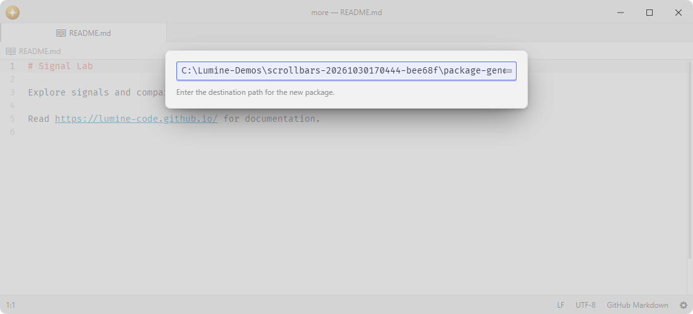

# package-generator

Generate ready-to-edit packages and syntax themes.

Fork of [pulsar-edit/pulsar](https://github.com/pulsar-edit/pulsar) (`packages/package-generator`).

## Features

- **Package scaffolds**: creates a JavaScript package with a command, CSS, specs, and current quality tooling.
- **Syntax theme scaffolds**: creates a CSS custom-property palette and a registered syntax theme.
- **Development links**: links generated projects into `packages` or `packages-dev` without overwriting an existing entry.
- **Project handoff**: adds the generated project to the current workspace immediately.



## Installation

To install `package-generator` search for it in the Install pane of the Lumine settings, or run the command `lumine --install lumine-code/package-generator`.

## Commands

Commands available in `lumine-workspace`:

- `package-generator:generate-package`: create a JavaScript package,
- `package-generator:generate-syntax-theme`: create a syntax theme package.

Tree-sitter language packages require a real parser, queries and capture fixtures, so maintainers create them with `lem grammar new` in a full Lumine workspace rather than this general-purpose generator.

## Customization

Generated editor packages seed their package-local accent hook from the UI accent:

```css
:root {
  --your-package-accent-color: var(--accent-indicator-color);
}
```

Destination paths are limited to 32768 UTF-16 units before extraction or filesystem work. Oversized drafts remain intact and confirmation becomes available after the path is shortened.

## Contributing

Got ideas to make this package better, found a bug, or want to help add new features? Just drop your thoughts on GitHub. Any feedback is welcome!
